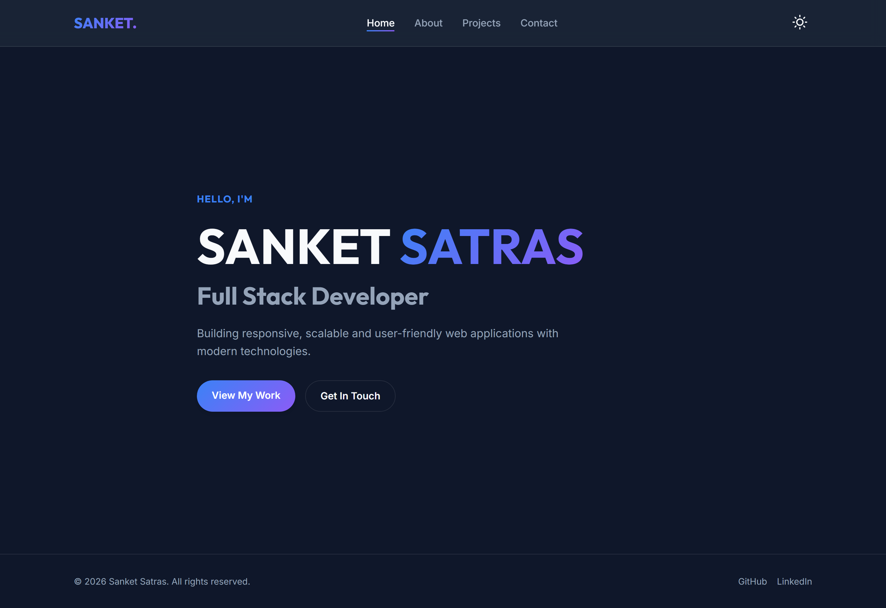
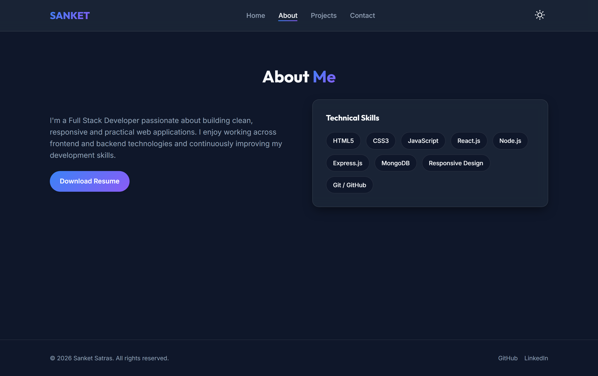
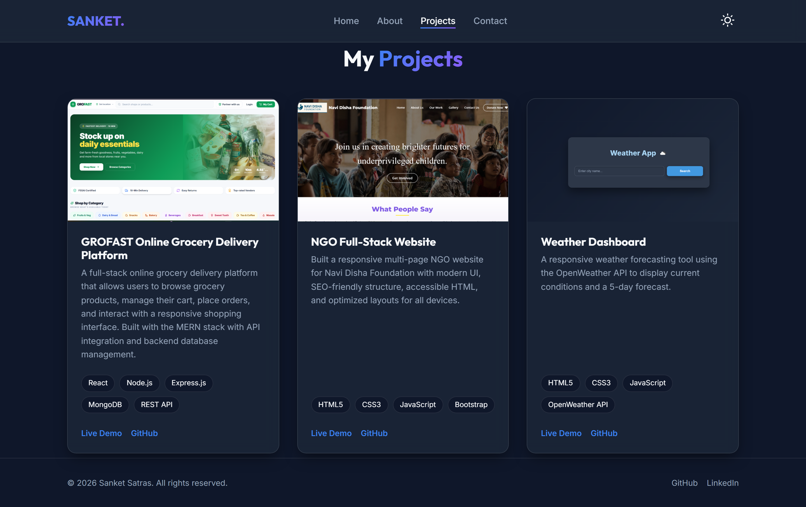
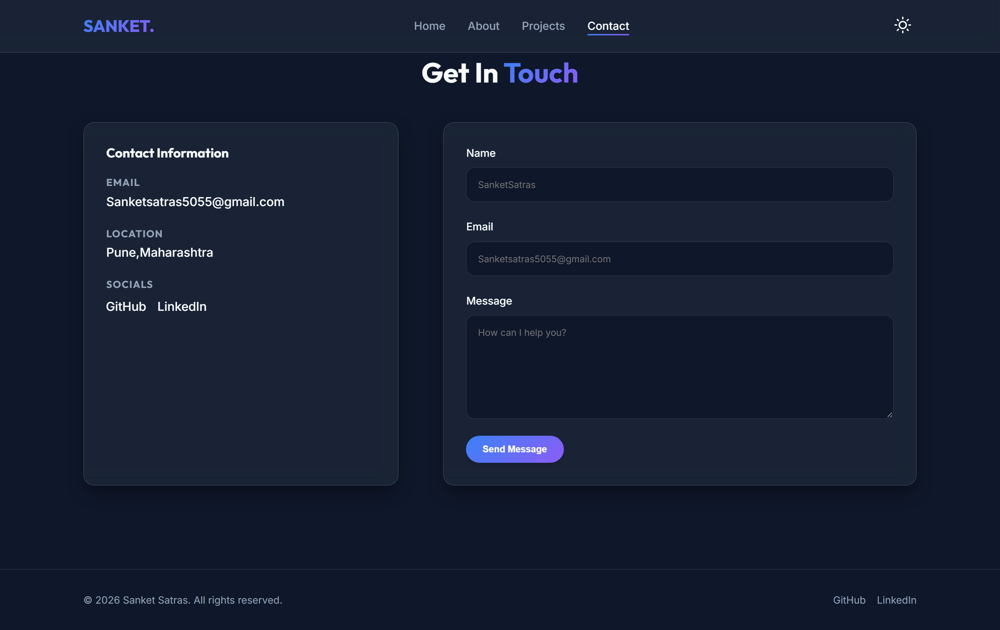
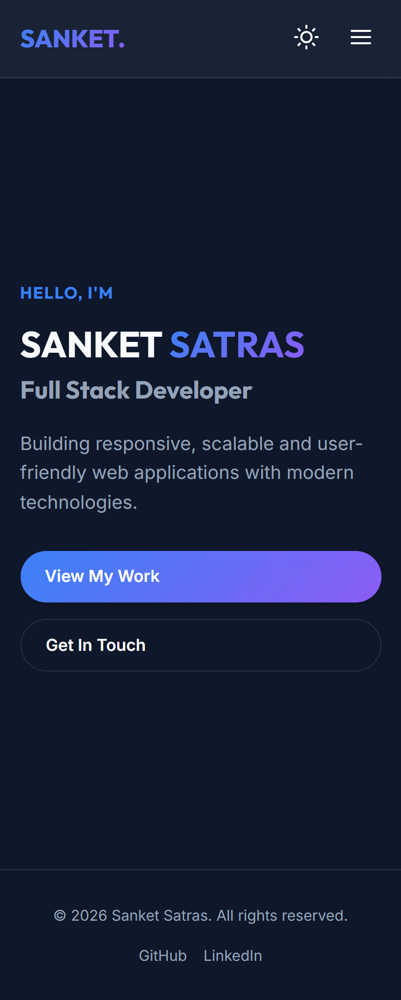
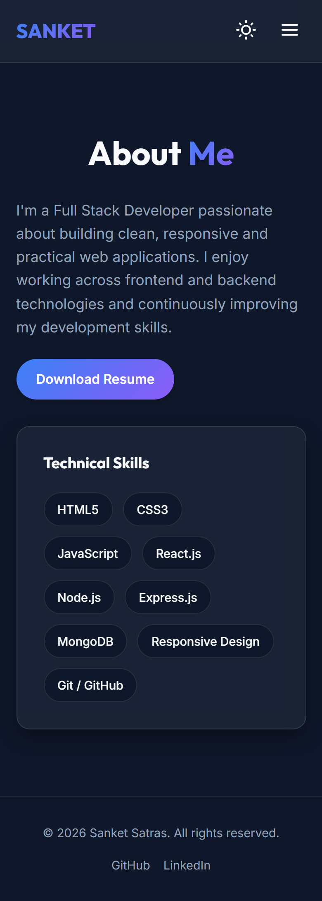
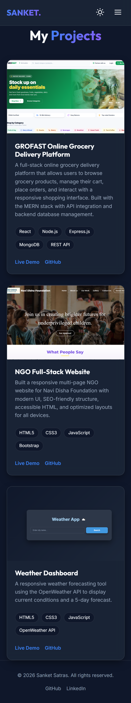
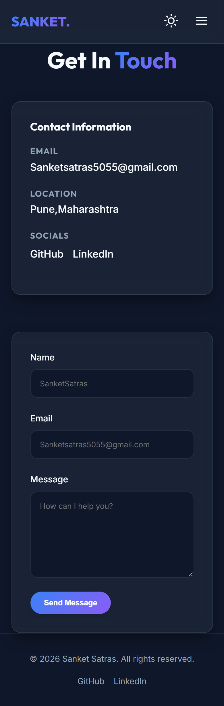

# Sanket Satras - Personal Portfolio Website

A modern, responsive, and accessible personal portfolio website created to showcase full stack development projects, technical skills, and professional experience.

---

## 🎯 Objective

The primary objective of this project is to build a high-performance, visually engaging, and responsive personal portfolio that serves as a central hub for presenting web development projects, technical proficiencies, and contact information. The portfolio is engineered with clean vanilla frontend technologies to ensure optimal loading speeds, seamless cross-device compatibility, and an intuitive user experience for recruiters, clients, and collaborators.

---

## 🛠️ Tech Stack

- **Markup & Structure**: HTML5 (Semantic elements, SEO-optimized meta tags, accessibility attributes)
- **Styling & Layout**: CSS3 (CSS Custom Properties / Variables, Flexbox, CSS Grid, Media Queries, Glassmorphism, Gradient Effects)
- **Typography**: Google Fonts ([Outfit](https://fonts.google.com/specimen/Outfit) for headings, [Inter](https://fonts.google.com/specimen/Inter) for body)
- **Scripting & Logic**: JavaScript ES6+ (DOM manipulation, Event Handling, `IntersectionObserver` API, `localStorage` API)
- **Icons & Assets**: Custom inline SVG icons and optimized project imagery
- **Tooling & Hosting**: Git, GitHub, VS Code Live Server

---

## ✨ Features Implemented

- **Modern Glassmorphic UI**: Sleek, premium dark-themed design featuring frosted glass navigation, cards, and vibrant gradient accents.
- **Theme Toggle (Dark / Light Mode)**: Seamless theme switching that auto-detects system preferences (`prefers-color-scheme`) and persists user selection across sessions via `localStorage`.
- **Fully Responsive Layout**: Mobile-first, adaptive layouts tailored across extra-small mobile screens, tablets, laptops, and ultra-wide desktop monitors using CSS Grid and Flexbox.
- **Collapsible Mobile Navigation**: Smooth hamburger toggle menu with full-screen animated clip-path transitions for smaller viewports.
- **Project Showcase**: Rich project cards displaying live demo links, GitHub source repositories, and technical badge tags for:
  - *GROFAST Online Grocery Delivery Platform* (MERN Stack)
  - *Navi Disha Foundation NGO Website* (Full-Stack / Bootstrap)
  - *Weather Dashboard* (REST API / JavaScript)
- **Skills & Resume Section**: Categorized technical skill tags and a direct download button for the author's resume.
- **Interactive Contact Form & Socials**: Functional contact interface with form validation alongside direct email and social profiles.
- **Zero Heavy Dependencies**: Built purely with native web standards without external libraries, ensuring near-instant page load and low memory footprint.

---

## 📂 Folder Structure


portfolio_website/
│
├── index.html              # Home page with hero introduction and quick CTAs
├── about.html              # Profile summary, background, and technical skills stack
├── projects.html           # Project showcase cards with live demos & source links
├── contact.html            # Contact form, location, and social links
│
├── css/
│   └── style.css           # Core styling, CSS variables, glassmorphism, responsive queries
│
├── js/
│   └── script.js           # Dark mode toggle, mobile navigation, scroll animations
│
├── assets/
│   └── images/             # Project preview screenshots and images
│       ├── grofast.png
│       ├── ngo.png
│       └── weather.png
│
├── screenshots/            #  page previews
│   ├── home-desktop.png
│   ├── home-mobile.png
│   ├── about-desktop.png
│   ├── about-mobile.png
│   ├── projects-desktop.png
│   ├── projects-mobile.png
│   ├── contact-desktop.png
│   └── contact-mobile.png
│
└── README.md               # Project documentation
```

---

## 🚀 Setup or Run Instructions

Since this is a lightweight static website, no complex build steps, package managers, or backend runtimes are required.

### 1. Clone the Repository
```bash
git clone https://github.com/SanketSatras/portfolio-website.git
```

### 2. Navigate to Project Directory
```bash
cd portfolio-website
```

### 3. Run Locally
Choose any of the following methods to view the website:

- **Option A (VS Code Live Server - Recommended)**:
  1. Open the project folder in VS Code.
  2. Right-click on `index.html` and select **"Open with Live Server"**.
  3. The website will automatically open at `http://127.0.0.1:5500/index.html`.

- **Option B (Direct Browser)**:
  - Double-click `index.html` or drag and drop it directly into any modern web browser (Google Chrome, Microsoft Edge, Mozilla Firefox, Safari).

- **Option C (Node.js / Python HTTP Server)**:
  ```bash
  # Using Python 3:
  python -m http.server 8000
  # Then visit http://localhost:8000 in your browser
  ```

---

## 🌐 Live Project Link

- **Live Website**: [https://sanketsatras.github.io/portfolio-website/](https://sanketsatras.github.io/portfolio-website/) *(or your custom deployed URL)*
- **Source Code Repository**: [https://github.com/SanketSatras/portfolio-website](https://github.com/SanketSatras/portfolio-website)

---

## 📸 Screenshots

### Desktop View (1440px)

#### Home Page


#### About Page


#### Projects Section


#### Contact Page


---

### Mobile View (390px)

<div align="center">

| Home Mobile | About Mobile |
| :---: | :---: |
|  |  |

| Projects Mobile | Contact Mobile |
| :---: | :---: |
|  |  |

</div>

---

## 👤 Author Details

- **Name**: Sanket Satras
- **Role**: Full Stack Developer
- **Location**: Pune, Maharashtra, India
- **Email**: [Sanketsatras5055@gmail.com](mailto:Sanketsatras5055@gmail.com)
- **GitHub**: [@SanketSatras](https://github.com/SanketSatras/)
- **LinkedIn**: [Sanket Satras](https://www.linkedin.com/in/sanket-satras-a10023286)
- **Resume**: [Download Resume](https://drive.google.com/file/d/1cvKmXIofdTpk4sLWfwQuV-DGNlMj1X2D/view?usp=drivesdk)
